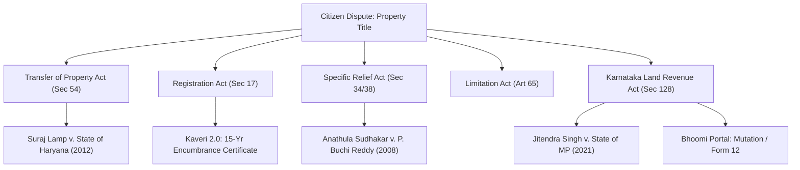

# NyayaSetu — Legal Relationship Knowledge Layer

**Specification Reference:** Section 27 (Indian Legal Relationship Architecture)  
**Database Implementation:** `backend/app/modules/legal_knowledge/models.py` (`LegalRelationship`)  
**Runtime Query Engine:** `backend/rag/search/legal_relationship_layer.py` (`LegalRelationshipEngine`)  
**Data Artifact:** `backend/rag/data/legal_relationships.json`

---

## 1. Overview & Architecture

The Legal Relationship Knowledge Layer establishes a structured semantic linkage over Indian statutory law, landmark Supreme Court jurisprudence, procedural rules, and citizen legal problems.

Rather than retrieving disconnected sections, the system navigates typed relationships to assemble multi-statute legal advice without introducing a heavy graph database dependency.

---

## 2. Core Relationship Types

The relationship structure is typed and indexed by:

| Relationship Type | Description | Representative Example |
| :--- | :--- | :--- |
| **`REPLACES`** | Maps repealed colonial statutes to active Bharatiya Sanhitas 2023 | IPC Section 420 $\rightarrow$ BNS Section 318(4) |
| **`INTERPRETS`** | Supreme Court / High Court precedent establishing binding ratio | Suraj Lamp $\rightarrow$ TPA Section 54 (GPA sales invalid for title) |
| **`APPLIES_TO_PROBLEM`** | Direct statutory assembly for a standardized citizen legal dispute | Cheque Bounce $\rightarrow$ NI Act 138, 139, 142 |
| **`GOVERNED_BY_RULE`** | Parent Bare Act connecting to operative procedural Rules/Regulations | RTI Act 2005 $\rightarrow$ Central RTI Rules 2012 |
| **`REMEDY_AUTHORITY`** | Connects legal grievance to competent judicial forum or officer | Section 138 NI Act $\rightarrow$ Judicial Magistrate First Class (JMFC) |
| **`REQUIRED_DOCUMENT`** | Mandatory documentary evidence for statutory procedure | Property Registration $\rightarrow$ e-Khata, 15-Year EC, PAN/Aadhaar |
| **`STATUTORY_DEADLINE`** | Limitation Act or statutory notice timeline | NI Act Notice $\rightarrow$ 30 Days from Cheque Return Memo |

---

## 3. Key Multi-Statute Workflow Clusters

### 3.1 Property Ownership & Title Verification (Karnataka)
1. **Transfer of Property Act, 1882 (Section 54):** Transfer of ownership over Rs 100 must be by registered deed.
2. **Registration Act, 1908 (Section 17):** Non-registration invalidates document as evidence of title (Section 49).
3. **Suraj Lamp & Industries (Supreme Court):** GPA, Agreement to Sell, or Will transfers do not convey title.
4. **Karnataka Land Revenue Act, 1964 (Section 128):** Mutation in Bhoomi is fiscal record; does NOT create or extinguish title (*Jitendra Singh*).
5. **Specific Relief Act, 1963 (Section 34):** Injunction cannot be sought without declaratory relief where title is under cloud (*Anathula Sudhakar*).
6. **Limitation Act, 1963 (Article 65):** 12-year statutory period for adverse possession against private property.

### 3.2 Cheque Bounce Dispute (Section 138 NI Act)
1. **Negotiable Instruments Act, 1881 (Section 138):** Cheque dishonour for insufficient funds.
2. **Statutory Demand Notice:** Dispatched within **30 days** of receiving bank memo.
3. **Payment Window:** Accused gets **15 days** from notice receipt to pay.
4. **Court Complaint (Section 142):** Filed before Judicial Magistrate First Class (JMFC) within **30 days** of window expiry.
5. **Statutory Presumption (Section 139):** Presumption of legally enforceable debt (*Rangappa v. Sri Mohan*).
6. **Interim Compensation (Section 143A):** Court can order up to 20% interim deposit.

### 3.3 Domestic Violence & Matrimonial Relief
1. **PWDVA, 2005 (Section 3 & 12):** Protection, residence, and monetary orders.
2. **Hiral P. Harsora (Supreme Court):** Struck down 'adult male', allowing complaints against female in-laws.
3. **Rajnesh v. Neha (Supreme Court):** Mandatory comprehensive Affidavit of Assets and Liabilities.
4. **BNSS, 2023 (Section 144):** Maintenance for wife, minor children, and elderly parents.
5. **Muslim Women Protection Act, 1986 (Section 3):** Lifetime maintenance (*Danial Latifi*).

### 3.4 Delayed Home Possession (RERA & Consumer Protection)
1. **RERA, 2016 (Section 18):** Right to full refund with interest or monthly delay interest.
2. **Imperia Structures v. Anil Patni (Supreme Court):** Concurrent remedies in Consumer Forum and RERA.
3. **Pioneer Urban (Supreme Court):** One-sided builder clauses declared unfair trade practice.
4. **CCPA Dark Patterns Guidelines, 2023:** Drip pricing and hidden charges prohibited.

---

## 4. Integration with Hybrid Search

The `LegalRelationshipEngine` dynamically augments the hybrid retrieval pipeline:
1. When a query is classified into a known legal problem cluster, the engine injects primary statutory provisions and landmark precedents into the candidate retrieval set.
2. Precedent shortcodes are cross-checked to ensure obsolete interpretations are flagged with their contemporary status.
